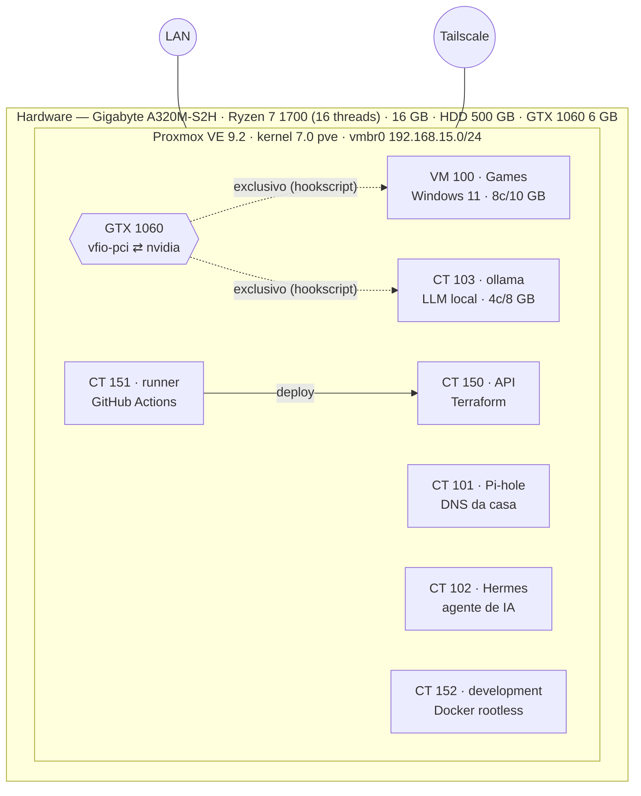

# 🏠 proxmox-homelab

Documentação e código de um homelab **Proxmox VE 9** rodando em hardware doméstico barato (Ryzen 7 1700 + GTX 1060 + HD de 500 GB), com **uma GPU compartilhada entre uma VM de jogos e um container de IA**, DNS da casa, runner de CI, ambiente de desenvolvimento com Docker rootless e backup automático.

> Tudo aqui é real e extraído de um host em produção, já sanitizado (sem MACs, tokens, e-mails ou nomes de dispositivos). IPs são todos RFC 1918.

## O que tem de interessante

| Tema | Resumo | Onde |
|------|--------|------|
| 🎮 **GPU compartilhada** | A mesma GTX 1060 serve uma VM Windows 11 (passthrough/VFIO) *ou* um CT LXC com Ollama (driver NVIDIA no host). A troca é automática via *hookscripts*, com exclusão mútua. | [docs/gpu-sharing.md](docs/gpu-sharing.md) |
| 🐳 **Docker rootless em LXC não privilegiado** | Ambiente de dev com dois usuários isolados, cada um com seu daemon Docker, `idmap` customizado e o truque do AppArmor. | [docs/rootless-docker-lxc.md](docs/rootless-docker-lxc.md) |
| 🌡️ **Temperatura no Summary do PVE** | Patch idempotente que mostra a temperatura da CPU na UI web (e reaplica após upgrades). | [scripts/ui](scripts/ui) |
| 🏗️ **IaC com Terraform** | Containers criados com o provider `bpg/proxmox`; token de API por variável de ambiente. | [terraform](terraform) |
| 💾 **Backup** | `vzdump` diário em snapshot + zstd + política de retenção. | [docs/backup-and-power.md](docs/backup-and-power.md) |
| ⏰ **Desligar de noite, ligar às 06:00** | `rtcwake -m off` e as pegadinhas de BIOS/Wake-on-LAN. | [docs/backup-and-power.md](docs/backup-and-power.md) |
| 🤖 **Controle por Telegram** | Bot que liga/desliga convidados, troca a GPU e mostra temperatura (somente chats autorizados). | [docs/automation.md](docs/automation.md) |

## Arquitetura



## Inventário

| ID | Tipo | Nome | Papel | CPU / RAM / Disco | Observações |
|----|------|------|-------|-------------------|-------------|
| 100 | VM (OVMF, q35) | Games | Windows 11 com GPU em passthrough | 8 / 10 GB / 200 GB | TPM 2.0, VirtIO, hookscript de GPU |
| 101 | CT | Pihole | DNS/bloqueio de anúncios da casa | 2 / 2 GB / 8 GB | IP fixo, `onboot` |
| 102 | CT | Hermes | Agente de IA | 2 / 4 GB / 10 GB | `onboot` |
| 103 | CT | ollama | Inferência de LLM na GPU | 4 / 8 GB / 40 GB | `/dev/nvidia*` mapeados, hookscript |
| 150 | CT | gastobs | API de um app pessoal | 2 / 2 GB / 16 GB | Terraform, `protection=1` |
| 151 | CT | gastobs-runner | Runner self-hosted do GitHub Actions | 2 / 2 GB / 16 GB | Terraform |
| 152 | CT | development | Dev com Docker rootless e CLIs | 4 / 8 GB / 60 GB | `idmap` customizado, backup diário |

Configs sanitizadas em [config/](config).

## Estrutura do repositório

```
docs/       guias detalhados (GPU, Docker rootless, backup/energia, automação, lições)
config/     storage.cfg, jobs.cfg, modprobe, GRUB e .conf de cada convidado
scripts/    gpu/ (troca de driver) · hookscripts/ (exclusão mútua) · ui/ (patch de temperatura)
terraform/  exemplo de CT Ubuntu com bpg/proxmox
```

## Como reaproveitar

1. Leia [docs/gpu-sharing.md](docs/gpu-sharing.md) e ajuste os endereços PCI (`lspci -nn`) e os IDs `vendor:device` em `config/host/vfio.conf`.
2. Copie `scripts/gpu/*.sh` para `/usr/local/sbin/` e `scripts/hookscripts/*.sh` para `/var/lib/vz/snippets/` (`chmod +x`).
3. Associe: `qm set <VM> --hookscript local:snippets/gpu-vm.sh` e `pct set <CT> --hookscript local:snippets/gpu-ct.sh`.

> ⚠️ Scripts mexem em drivers e PCI em tempo de execução. Teste com os convidados desligados e tenha acesso físico/console à máquina.

## Licença

MIT — veja [LICENSE](LICENSE).
