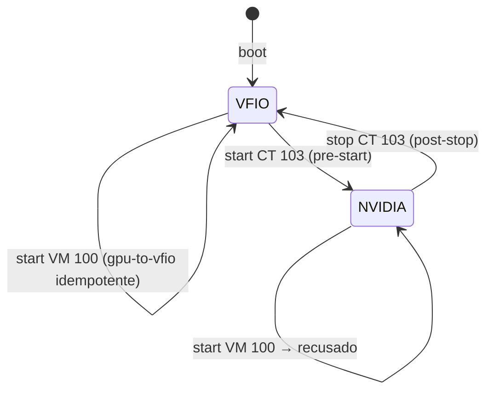

# GPU compartilhada entre VM e container

**Problema:** uma única GPU (GTX 1060) e dois usos que não convivem: jogar no Windows (passthrough PCIe exige `vfio-pci`) e rodar LLMs no Ollama (precisa do driver `nvidia` no host, exposto ao LXC via `/dev/nvidia*`).

**Solução:** o host sobe com a GPU presa ao `vfio-pci`; ao iniciar o CT, ela é religada ao `nvidia` em tempo de execução, e ao parar, devolvida ao `vfio-pci`. Os dois nunca rodam juntos.

## Peças

| Peça | Função |
|------|--------|
| `config/host/vfio.conf` | `options vfio-pci ids=10de:1c03,10de:10f1` — reserva GPU e áudio HDMI no boot |
| `config/host/blacklist-gpu.conf` | Bloqueia `nouveau`, `nvidia`, `nvidiafb` para o host não pegar a GPU sozinho |
| `config/host/grub-cmdline.txt` | `iommu=pt`, desliga `efifb`/`vesafb` e `sysfb_init` para o host não usar o framebuffer da GPU |
| `scripts/gpu/gpu-to-nvidia.sh` | `unbind` do vfio → `driver_override=nvidia` → `modprobe` → `drivers_probe`. A função de áudio permanece no `vfio-pci` |
| `scripts/gpu/gpu-to-vfio.sh` | `rmmod nvidia_uvm/nvidia_modeset/nvidia` → devolve GPU e áudio ao `vfio-pci` |
| `scripts/hookscripts/gpu-vm.sh` | `pre-start` da VM: recusa se o CT estiver rodando; chama `gpu-to-vfio` |
| `scripts/hookscripts/gpu-ct.sh` | `pre-start` do CT: recusa se a VM estiver rodando; chama `gpu-to-nvidia`; `post-stop` devolve ao vfio |

## Detalhes que importam

- **Idempotência + `flock`**: ambos os scripts usam `flock` em `/run/gpu-switch.lock` e saem cedo se a GPU já está no estado desejado, então hooks concorrentes ou repetidos não quebram.
- **Exclusão mútua nos hooks**: sair com código ≠ 0 em `pre-start` aborta o start do convidado, com mensagem clara no log da tarefa.
- **`driver_override`** é o que permite escolher o driver sem mexer em `modprobe.d` nem reiniciar.
- **`nvidia-modprobe -u -c0`** cria `/dev/nvidia-uvm*`, necessários para CUDA dentro do LXC.
- **Container**: `dev0..dev3` em `config/guests/ct-103.conf` mapeiam `/dev/nvidia0`, `nvidiactl`, `nvidia-uvm`, `nvidia-uvm-tools`; o driver dentro do CT precisa ter a **mesma versão** do host (instalar só as bibliotecas, `--no-kernel-modules`).
- Com o CT parado, `nvidia-smi` no host falha — é o esperado, pois a GPU está no `vfio-pci`.

## Diagrama de estados

